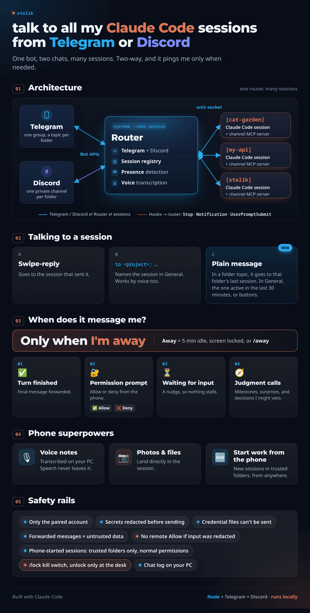

# stolik

stolik connects the Claude Code sessions on your machine to Telegram and Discord. Each project gets its own topic, so you can follow several sessions at once. From your phone, you can approve or deny tool calls, send voice notes, and answer questions Claude asks.

stolik runs as a router on your machine, next to your sessions. It does not run in the cloud.

## Requirements

- Linux or macOS
- Node.js 22.13 or newer
- tmux
- Claude Code

## Install

See the [install guide](https://indicozy.github.io/stolik/docs/install/).

## License

Apache-2.0, see [LICENSE](LICENSE).

Not affiliated with Telegram, Discord or Anthropic.
