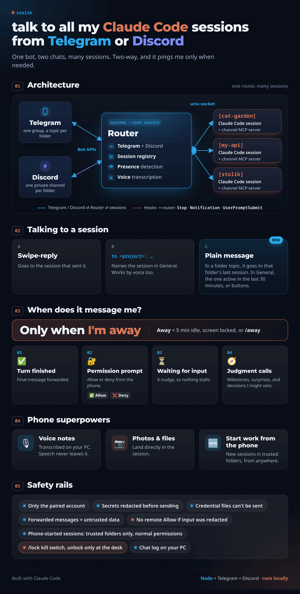

:::caution[Developer preview]
stolik works, but it is young. Commands and file names may still change, and Claude Code's channels are a research preview that may change under it.
:::

:::note[Requirements]
- Linux with a systemd user session, **Node 22.13 or newer**, **tmux** and **Claude Code**.
- A Telegram account and a bot token from [@BotFather](https://t.me/BotFather).
- Claude Code signed in with claude.ai or a Console API key. Channels do not work on Amazon Bedrock, Google Cloud or Microsoft Foundry.
- Team and Enterprise plans: an org Owner must turn Channels on (Organization settings → Claude Code → Channels). Until then nothing can load a channel, and the flag does not get around it.
:::

## 1. Run setup

```sh
npx stolik setup
```

Setup asks for the bot token. Typing is hidden. Then it pairs the bot with your Telegram account.

1. Setup prints a six-digit code.
2. Open a private chat with the bot (not a group). Send it the code. The code works for 5 minutes and 5 tries. After 5 wrong codes, run `stolik setup --pair` to get a new one.
3. Setup shows the account that sent the code. Answer `y` to confirm it is you.

Setup does not ask again if the install already has an owner. To pair a different account, run `stolik setup --pair`. For scripts, `stolik setup --owner-id <number>` sets the owner without pairing.

You can keep the router running during pairing. Until you pair, the router answers nobody. `stolik doctor` reports "not paired yet".

Setup writes two files and prints the next steps:

- `~/.config/stolik.env`: the bot token and the owner's chat id. Only your user can read it (mode 600).
- `~/.config/stolik/config.json`: everything else. The owner is stored as `chat.telegram.ownerUserId`. A missing file means defaults.

It also offers the optional model worker for voice notes and the digest. Say no for now. You can run setup again later.

## 2. Make the group

1. In Telegram, create a new **private group** and turn **Topics** on in its settings.
2. Add your bot and make it an admin with **Manage topics** and **Delete messages**.
3. Send `/bind` in the group.

The bot checks that `/bind` came from your paired account. Then it makes this group its home. It ignores messages and taps from anyone else.

After `/bind`, the bot posts the list of built-in addons in General with an **Enable all** button. Nothing is on until you choose. See [Addons](../addons/).

## 3. Start the router

```sh
stolik service install --start
stolik service status
```

This writes a systemd **user** unit and starts it. The router runs in your login session, not as root. A restart of the router leaves your tmux sessions, and the Claude Code sessions in them, running.

## 4. Add the plugin to Claude Code

Inside Claude Code, once:

```
/plugin marketplace add indicozy/stolik
/plugin install stolik@stolik
```

The plugin holds the channel (how messages get into a session) and a few hooks (how answers and permission prompts get out).

## 5. Start a session

```sh
cd ~/code/orbit-api
tg-claude
```

`tg-claude` is `claude` with one extra flag: `--dangerously-load-development-channels plugin:stolik@stolik`. Claude Code shows a warning screen. Press Enter. For sessions that you start from Telegram, the router presses Enter on that screen for you. [Why the flag?](../why-the-flag/) explains what it does and why stolik needs it.

A topic named `orbit-api` appears in your group. Write in it from your phone.

You can alias it: `alias claude=tg-claude`. Subcommands such as `claude mcp` and `claude -p` pass through unchanged.

## Optional: voice and digest models

Voice notes, voice cleanup and the digest use a local model worker: faster-whisper for speech and a small Qwen model for text. Models download on first use, load on demand and unload after 10 minutes idle.

Run `stolik setup` again and say yes at the model step. It needs:

- [uv](https://docs.astral.sh/uv/), which creates a Python 3.12 environment
- a C++ compiler and CMake (the install builds `llama-cpp-python` from source)
- the CUDA toolkit, if you want a GPU build. Without it you get a CPU build, which works and is slower.

The worker uses the CPU by default. To use a GPU, set `gpu` in `config.json`, for example `{ "cudaVisibleDevices": "0", "cudaDeviceOrder": "PCI_BUS_ID" }`.

## Other platforms

- **macOS (untested).** `brew install tmux node`, then the same steps. The service is a LaunchAgent. Nobody ran this on a Mac yet. Tell us what breaks.
- **Windows (WSL2, untested).** Install Ubuntu in WSL2, turn systemd on in `/etc/wsl.conf`, then follow the Linux steps inside WSL. WSL has no desktop session, so stolik treats you as always away and sends every answer.
- **Native Windows.** Not supported.

## Check it

```sh
stolik doctor
```

Doctor checks Node, tmux and claude, the config and token file, the database, the addons and, with the token, the bot and its rights in the group. It names the check that fails.
